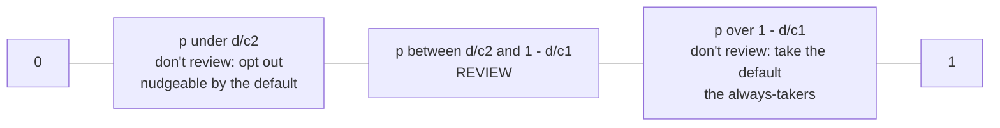

# Who actually reviews the default — and who gets privacy when reviewing is costly?

## How this question is formed

- Some people never review: they always take the default — "the always-takers".
- People review only if $p > \frac{d}{c_2}$ and $p < 1 - \frac{d}{c_1}$; the interval exists only if $d < \frac{c_1 c_2}{c_1 + c_2}$.
- Reading the model: $p$ = probability the default is right; $d$ = cost of reviewing (attention, administrative burden); $c_1$ = cost of wrongly accepting a bad default; $c_2$ = cost of wrongly rejecting a good one.
- If $d$ varies between people, the same friction gives people different access to privacy — an administrative burden.
- Less attention might incur a "lulling effect".
- It is also a delegation / agent problem: "Who controls the agent that reviews permissions, and how can the user inspect or override its decisions?"

## The p line (labels corrected)

The photo labels the middle interval "the always-takers" and swaps the two tick labels. Following the inequalities above, the middle is where people review; the always-takers are at the high-$p$ end, where taking the default without reviewing is cheapest.

Related: [[hub-privacy]]
